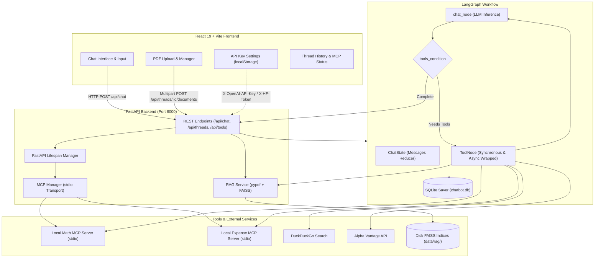

# LangGraph Unified AI Agent: FastAPI, React, Local MCP & Persistent PDF RAG

An enterprise-ready, modular AI assistant architecture featuring **LangGraph** orchestration, persistent conversation memory via **SQLite**, native tools, dynamic **Model Context Protocol (MCP)** tool discovery, and thread-isolated **PDF Retrieval-Augmented Generation (RAG)** powered by FAISS.

Built with a modern decoupled stack: a high-performance **FastAPI** backend running on **Python 3.14.5** and an interactive, glassmorphic **React 19 (Vite)** frontend.

---

## 📌 Project Overview

Traditional conversational AI chatbots often suffer from state amnesia across restarts, lack standardized access to external systems, and struggle to cite evidence from local documents. This project implements a unified architecture that solves these challenges:

- **Stateful Conversational Graphs:** LangGraph manages the agent's cyclic decision-making and tool-execution loop with checkpointing stored in SQLite.
- **Model Context Protocol (MCP):** Connects to external tools and services over standard I/O (`stdio`), enabling clean separation of concerns and dynamic runtime tool discovery.
- **Thread-Isolated PDF RAG:** Uploaded documents are parsed, chunked, vector-indexed using FAISS, and queried with exact source metadata citations (file and page numbers).
- **Client-Side API Key Support:** Users can provide their own OpenAI API Key or Hugging Face Token via an in-app settings modal, stored safely in browser `localStorage`.

---

## ⚡ Key Features

- **Decoupled Architecture:** Clean separation between the React client and the FastAPI backend via JSON REST APIs.
- **Unified Tool Registry (10 Tools Active):**
  - **Native Web Search (`duckduckgo_search`):** Real-time web querying without API key requirements.
  - **Native Calculator (`calculator`):** Precise arithmetic operations via Python execution.
  - **Native Stock Quotes (`get_stock_price`):** Market quotes fetched via Alpha Vantage.
  - **Native Document Retrieval (`rag_search_tool`):** Contextual vector similarity search across user-uploaded PDFs.
  - **Local Math MCP Server (`mcp_add`, `mcp_multiply`, `mcp_power`):** FastMCP tool execution over `stdio`.
  - **Local Expense MCP Server (`add_expense`, `list_expenses`, `summarize`):** FastMCP ledger management over `stdio`.
- **Persistent SQLite Checkpointing:** Every conversation turn, state delta, and message is preserved across server restarts in `chatbot.db`.
- **Thread-Specific Document Indexing:** Each chat thread maintains its own isolated FAISS index under `./data/rag/{thread_id}/`.
- **Per-Turn Dynamic Model Binding:** Supports `ChatOpenAI` (default) and `ChatHuggingFace`, with automatic runtime key binding.
- **Glassmorphic React Interface:** Dark-mode design system with conversation sidebar, live MCP connection status badges, tool registry modal, PDF upload manager, and API key management modal.

---

## 🏛️ System Architecture



---

## 🛠️ Technology Stack

| Layer | Technologies |
|---|---|
| **Frontend** | React 19, Vite, Vanilla CSS (Design Tokens, Glassmorphism), Inter Font |
| **Backend** | FastAPI, Uvicorn, Pydantic v2, Python 3.14.5 |
| **Agent & Workflow** | LangGraph, LangGraph Checkpoint SQLite, LangChain Core |
| **LLM Integrations** | `langchain-openai` (`ChatOpenAI`), `langchain-huggingface` (`ChatHuggingFace`) |
| **MCP Integration** | `langchain-mcp-adapters`, `mcp` (FastMCP stdio servers) |
| **RAG & Embeddings** | `pypdf`, `RecursiveCharacterTextSplitter`, `faiss-cpu`, `OpenAIEmbeddings` |
| **Database** | SQLite3 (`chatbot.db`) |

---

## 📁 Repository Structure

```
AI-Chatbot/
├── backend/
│   ├── main.py                  # FastAPI application with CORS & lifespan discovery
│   ├── requirements.txt         # Curated dependencies for Python 3.14.5
│   ├── chatbot.py               # Unified LangGraph StateGraph, SQLite checkpoints & execution
│   ├── mcp_manager.py           # Modular MCP Manager (local stdio discovery & tool lifecycle)
│   ├── mcp_math_server.py       # Local stdio FastMCP Math Server (mcp_add, mcp_multiply, mcp_power)
│   ├── mcp_expense_server.py    # Local stdio FastMCP Expense Server (add_expense, list_expenses, summarize)
│   ├── rag_service.py           # Persistent PDF RAG service (PdfReader, RecursiveSplitter, FAISS)
│   ├── test_rag_integration.py  # 11-step integration test suite
│   ├── tools.py                 # Native DuckDuckGo, Calculator, Stock Price & RAG tools
│   ├── .env.example             # Backend environment template
│   └── __init__.py              # Package marker
├── frontend/
│   ├── src/
│   │   ├── App.jsx              # React UI with MCP status, PDF upload/delete, API key modal
│   │   ├── App.css              # Glassmorphic styling, animations, and modal styles
│   │   ├── index.css            # Typography, reset, and design tokens
│   │   └── main.jsx             # React DOM entry point
│   ├── package.json             # Frontend dependencies
│   ├── vite.config.js           # Vite build & dev proxy configuration
│   ├── index.html               # HTML entry point with Inter font
│   └── README.md                # Frontend documentation
├── .gitignore                   # Excludes secrets, databases, and build artifacts
├── LICENSE                      # MIT License
└── README.md                    # Project documentation
```

---

## 📋 Prerequisites

- **Python**: `3.14.5` (or compatible 3.10+; tested on Python 3.14.5)
- **Node.js**: `v20+` or `v22+`
- **Package Managers**: `pip` (Python) and `npm` (Node)

---

## 🚀 Installation & Setup

### 1. Clone the Repository
```bash
git clone https://github.com/abdulbarimr10-ai/AI-Chatbot.git
cd AI-Chatbot
```

### 2. Configure Environment Variables
Copy `backend/.env.example` to create your local `backend/.env`:
```powershell
Copy-Item backend\.env.example backend\.env
```

Open `backend/.env` and configure your API credentials:
```ini
# Primary LLM API Key (OpenAI)
OPENAI_API_KEY=your_openai_api_key_here

# Optional: Hugging Face Token (Alternative LLM)
HF_TOKEN=your_huggingface_token_here

# Optional: Alpha Vantage Key (For stock quote tool)
ALPHA_VANTAGE_API_KEY=your_alpha_vantage_key_here
```
> **Note:** If you prefer not to store keys in `.env`, you can also enter your OpenAI or Hugging Face keys directly in the frontend UI via the **🔑 API Keys** modal.

### 3. Install Backend Dependencies
```powershell
py -3.14 -m pip install -r backend\requirements.txt
```

### 4. Install Frontend Dependencies
```powershell
cd frontend
npm install
cd ..
```

---

## 🏃 Running the Application

Open two separate terminal windows:

### Terminal 1: Start FastAPI Backend
```powershell
py -3.14 -m uvicorn backend.main:app --host 127.0.0.1 --port 8000 --reload
```
- **Backend API**: [http://127.0.0.1:8000](http://127.0.0.1:8000)
- **Interactive Swagger Docs**: [http://127.0.0.1:8000/docs](http://127.0.0.1:8000/docs)
- **Health Check**: [http://127.0.0.1:8000/api/health](http://127.0.0.1:8000/api/health)
- **Tools Inventory**: [http://127.0.0.1:8000/api/tools](http://127.0.0.1:8000/api/tools)

### Terminal 2: Start React Frontend
```powershell
cd frontend
npm run dev
```
- **Frontend App**: [http://localhost:5173](http://localhost:5173)

---

## 🔌 API Endpoints Reference

| Method | Endpoint | Request Body | Description |
|---|---|---|---|
| `GET` | `/api/health` | None | Returns backend status, API version, and count of online MCP servers. |
| `GET` | `/api/tools` | None | Returns full inventory of native and MCP tools with server connection statuses. |
| `POST` | `/api/chat` | `{"message": "...", "thread_id": "optional-uuid"}` | Executes a graph turn with active native and MCP tools. |
| `GET` | `/api/threads` | None | Returns a list of all saved thread IDs from SQLite checkpoints. |
| `GET` | `/api/threads/{thread_id}` | None | Retrieves saved message history for the specified thread. |
| `POST` | `/api/threads/{thread_id}/documents` | Multipart form (`file`) | Uploads and indexes a PDF document for persistent RAG retrieval. |
| `GET` | `/api/threads/{thread_id}/documents` | None | Lists all indexed PDF documents for the thread. |
| `DELETE` | `/api/threads/{thread_id}/documents/{document_id}` | None | Deletes a document and its FAISS index. |

---

## 🧪 Testing & Verification

A comprehensive 11-step integration test suite verifies the complete RAG, MCP, and LangGraph workflow:

```powershell
py -3.14 backend\test_rag_integration.py
```

### Verified Test Cases:
1. Valid PDF upload, text extraction, and chunking.
2. Rejection of corrupt, empty, and non-PDF files.
3. FAISS vectorstore creation and disk persistence.
4. Index reload and querying across simulated backend restarts.
5. Exact text excerpt retrieval with file and page metadata citations.
6. Thread isolation (Thread B cannot access Thread A documents).
7. Document listing and index deletion.
8. Native tool registration and execution.
9. MCP server tool discovery and coexistence (10 tools active).
10. SQLite checkpoint continuity and multi-turn state persistence.
11. Full FastAPI multipart REST API upload and deletion lifecycle.

To verify the frontend build:
```powershell
cd frontend
npm run build
```

---

## 🔒 Security Considerations

- **Secret Isolation:** All credentials (`.env`, database files, API tokens) are strictly excluded via `.gitignore`.
- **Client-Side Key Management:** User-provided keys entered in the frontend settings modal are stored in browser `localStorage` and sent over request headers; they are never persisted to disk or databases.
- **Path Traversal Protection:** All document and thread IDs are sanitized through regex (`[a-zA-Z0-9_\-]`) to prevent directory traversal vulnerabilities.
- **File Upload Limits:** Strict file validation enforces PDF extensions and caps file sizes at 25 MB to prevent resource exhaustion.

---

## 📄 License

This project is open-source and available under the [MIT License](LICENSE).
